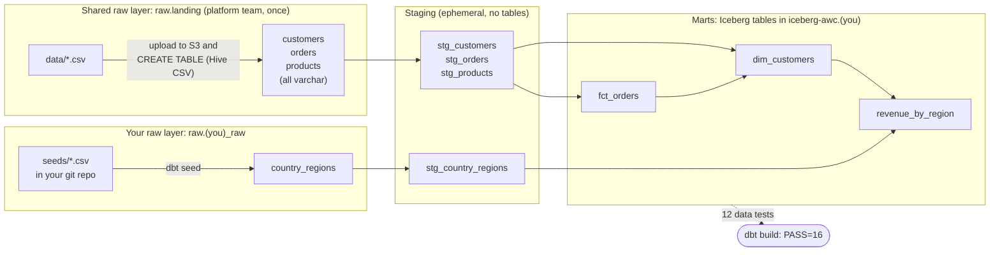

# dbt Lakehouse POC

A small dbt project for Trino on the Cloudera Lakehouse Engine. It reads two raw layers in the Trino Hive catalog
`raw` (a shared one prepared by the platform team, and your own one loaded from CSV files in this repository) and
builds Iceberg tables in the Harmony (Polaris) catalog `iceberg-awc`.



| Layer | Where | Objects |
| --- | --- | --- |
| Shared raw | `raw.landing.*` (CSV files on S3, all columns varchar; loaded by the platform team, read-only for you) | `customers`, `orders`, `products` (sample files in `data/`) |
| Your raw | `raw.<your schema>_raw.*` (Hive tables in the raw S3 bucket, loaded by `dbt seed` from `seeds/`) | `country_regions` (add your own CSV files) |
| Staging | ephemeral (compiled into the marts, no tables) | `stg_customers`, `stg_orders`, `stg_products`, `stg_country_regions`: clean and cast |
| Marts | Iceberg tables in `"iceberg-awc".<your schema>` | `fct_orders` (one row per order, with revenue), `dim_customers` (shipped orders and revenue per customer), `revenue_by_region` (shared and your raw data joined), with 10 tests |

## What you can do

- Read the shared raw layer `raw.landing`.
- Own your schemas `<username>` and `<username>_<anything>` (for example `user001`, `user001_raw`, `user001_dev`)
  in both catalogs: `raw` (your raw layer) and `iceberg-awc` (your marts). Create, change and drop tables in them;
  dbt creates the schemas on the first run.
- Other users' schemas are not visible to you, and yours are not visible to them.

## Step by step in a Coder workspace

### 1. Open your workspace

Sign in to Coder with your Keycloak login, create a workspace from the template **dbt-trino** (or start your
existing one) and open **VS Code** or the **Terminal**. The first start installs dbt (about 1 minute) and clones
this repository to `~/project`. Every later start pulls the latest commits, unless you have uncommitted changes.

### 2. Sign in to Trino (once a day)

```bash
trino-login
```

Enter your Keycloak password. Your token is saved in `~/.trino-jwt` and is valid for about 24 hours. Run
`trino-login` again when dbt reports `401` or `Unauthorized`. Open a new terminal afterwards, or keep using the
same one: `trino-login` also sets `TRINO_JWT` in the current shell.

### 3. Check the connection

```bash
cd ~/project
dbt debug
```

The output ends with `All checks passed!`.

### 4. Run the whole pipeline

```bash
dbt build
```

This loads your seeds, creates (or replaces) the marts and runs the tests: `PASS=16 ... ERROR=0`. Your raw tables
are now in `raw.<username>_raw` and the marts in `"iceberg-awc".<username>`.

### 5. Look at the results

```bash
dbt show --select fct_orders --limit 5
dbt show --inline "select country, count(*) as customers, sum(shipped_revenue) as revenue from {{ ref('dim_customers') }} group by 1 order by 3 desc"
```

**SQL editor in the browser (CloudBeaver):** click **SQL editor** on your workspace page. The connection
**Lakehouse Trino (&lt;username&gt;)** is ready: expand it to browse `iceberg-awc`, `raw` and `system` (you see only
your own schemas), click **SQL** in the toolbar, type a query and run it with the play button (or Cmd/Ctrl+Enter):

```sql
select * from "iceberg-awc".<username>.revenue_by_region
```

It runs as you, with the token of `trino-login` (a small proxy in the workspace adds it to every call), so the same
access rules apply. When the token has expired, queries fail with `401`: run `trino-login` in the terminal and run the
query again. Scripts you type in the editor are not saved when the workspace restarts: keep SQL you want to keep in
`~/project` (for example as an `analyses/` file) and commit it.

You can also query the tables from any other Trino client as `select * from "iceberg-awc".<username>.fct_orders`.
The catalog name contains a hyphen, so it needs the quotes.

### 6. Run parts of the pipeline

```bash
dbt ls                               # list models, sources and tests
dbt run --select fct_orders          # build one model
dbt run --select +dim_customers      # a model and everything upstream of it
dbt test --select dim_customers      # only the tests of one model
```

### 7. Work in a separate schema

```bash
DBT_LAKE_SCHEMA="${TRINO_USER}_dev" dbt build    # for example into user001_dev and raw.user001_dev_raw
```

Without the prefix, dbt uses your main schema again.

### 8. Add your own model

Create `models/marts/revenue_by_category.sql`:

```sql
select
    category,
    count(*) as orders,
    sum(revenue) as revenue
from {{ ref('fct_orders') }}
where status = 'shipped'
group by 1
```

Then `dbt run --select revenue_by_category` and `dbt show --select revenue_by_category`.

### 9. Add your own raw data

**Small files (up to a few MB): a dbt seed.** Put a CSV file with a header line in `seeds/`, for example
`seeds/targets.csv`:

```
region,target_revenue
Western Europe,1500
North America,2000
```

Load it into your raw layer and use it in a model with `ref()`:

```bash
dbt seed --select targets        # creates raw.<username>_raw.targets
dbt show --inline "select * from {{ ref('targets') }}"
```

dbt guesses the column types; set them in `seeds/schema.yml` (`column_types`) when it guesses wrong. A rerun
replaces the rows, and `dbt build` loads all seeds first. Commit the file to keep it.

**Tables you define yourself: SQL.** Run the statements with the project's `run_sql` macro (or in any Trino
client), as long as the schema is yours. `dbt show --inline` cannot run DDL: it appends a `limit`.

```bash
dbt run-operation run_sql --args '{sql: "create schema if not exists raw.user001_files"}'
dbt run-operation run_sql --args '{sql: "create table raw.user001_files.budget (region varchar, year integer, budget decimal(12, 2))"}'
dbt run-operation run_sql --args "{sql: \"insert into raw.user001_files.budget values ('Nordics', 2025, 1000.00)\"}"
dbt run-operation run_sql --args '{sql: "select * from raw.user001_files.budget"}'
```

When the SQL itself contains single quotes, wrap the arguments in double quotes and escape the inner ones (`\"`),
as in the insert above.

Declare such a table as a dbt source (in `models/sources.yml`, with `database: raw` and
`schema: user001_files`) and select from it with `source()`.

**Large files** cannot be uploaded from the workspace (you have no S3 credentials): ask the platform team to add
them to the shared raw layer (`hatch run lakehouse load`).

### 10. Documentation

```bash
dbt docs generate
dbt docs serve --port 8081
```

Open port 8081 through Coder's port forwarding (the workspace page lists the open ports).

### 11. Save your work in git

```bash
git checkout -b my-change
git add models/ seeds/
git commit -m "Add revenue by category"
git push -u origin my-change     # needs your own GitHub credentials (a personal access token)
```

dbt's output folders (`target/`, `logs/`) are ignored by git, so running dbt keeps the working tree clean and the
workspace can still pull updates at the next start.

## Settings

`profiles.yml` holds no credentials; every value comes from the environment, set by the workspace:

| Variable | Meaning |
| --- | --- |
| `TRINO_HOST`, `TRINO_PORT` | Trino coordinator (HTTPS) |
| `TRINO_USER`, `TRINO_JWT` | your username and token (`trino-login`) |
| `DBT_RAW_CATALOG`, `DBT_RAW_SCHEMA` | shared raw layer (default `raw`, `landing`); your seeds also go to `DBT_RAW_CATALOG` |
| `DBT_SEED_SCHEMA` | schema of your seeds (default: `<DBT_LAKE_SCHEMA>_raw`) |
| `DBT_LAKE_CATALOG`, `DBT_LAKE_SCHEMA` | target catalog and schema (default: `iceberg-awc`, your username) |

## Troubleshooting

| Message | Cause and fix |
| --- | --- |
| `401` / `Unauthorized` | The token expired: run `trino-login`. |
| `Access Denied: Cannot create schema ...` | The schema is not `<username>` or `<username>_*`: check `DBT_LAKE_SCHEMA` and `DBT_SEED_SCHEMA`. |
| `Access Denied: Cannot select from table ...` | The table is in another user's schema; ask the platform team for access. |
| `dbt: command not found` | The first start is still installing dbt; wait a minute and open a new terminal. |
| The workspace did not pull new commits | You have uncommitted changes in `~/project`: commit or stash them, then `git pull`. |
| SQL editor: `Failed to connect to /127.0.0.1:8091` | The token proxy is not running: restart the workspace (or run `nohup python3 ~/bin/trino-proxy.py >/tmp/trino-proxy.log 2>&1 &`). |
| SQL editor: `401` | The token expired or is missing: run `trino-login`, then run the query again. |
